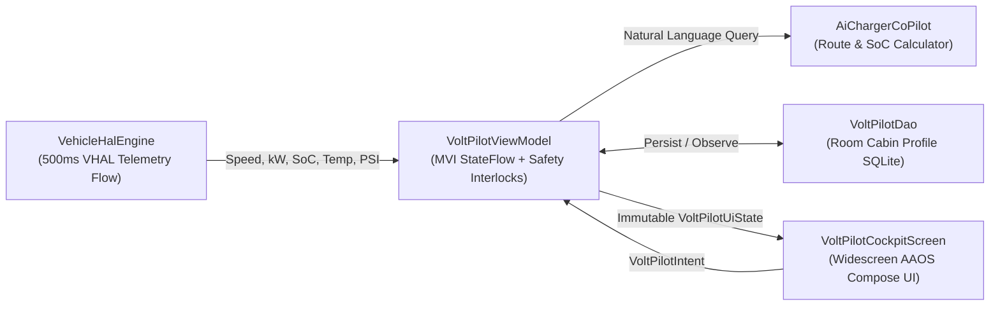

# VoltPilot EV ✦ — Android Automotive OS (AAOS) Cockpit & AI Co-Pilot

A widescreen **Android Automotive OS (AAOS)** In-Vehicle Infotainment (IVI) cockpit and hands-free AI route/charging co-pilot built with **Kotlin**, **Jetpack Compose (`Canvas`)**, **Clean Architecture (MVI)**, **Dagger Hilt**, **Room**, and a **Simulated Vehicle HAL (VHAL) Telemetry Engine**.

<p align="center">
  <!-- Paste your GitHub issue-uploaded GIF or screenshot URL here -->
  
</p>

---

## ✨ Key Engineering Highlights

1. **Android Automotive Driver Distraction & Safety Interlocks (`PARK` vs. `DRIVE`)**
   - Implements a gear-aware UX state machine (`P | R | N | D`).
   - Shifting from **`P` (Park)** into **`D` (Drive)** automatically enforces automotive distraction guidelines:
     - Locks out on-screen keyboard dialogs and switches the **AI Co-Pilot Bar** to hands-free voice preset cycling.
     - Automatically latches physical vehicle closures (**Frunk** and **Motorized Charge Port**) and blocks unlatching while in motion.
     - Updates the system safety badge from `🛡 PARKED · FULL UI UNLOCKED` to `🔒 DRIVE · LOW-DISTRACTION LOCKOUT`.

2. **Reactive Vehicle HAL (`VehicleHalEngine`) Telemetry Stream**
   - Emits 500ms VHAL telemetry ticks simulating real-world EV drivetrain physics across `Range`, `Comfort`, and `Sport` drive modes.
   - Dynamically models highway cruising speed (`MPH`), bidirectional power flow (`+kW` motor output vs. `-kW` regenerative braking), State of Charge (`SoC %`) consumption, 350V pack thermal preconditioning (`74°F → 82°F`), and 4-corner tire pressures (`PSI`).

3. **Custom Compose `Canvas` Automotive Instrumentation & Vector Navigation**
   - **240° Bidirectional Power/Regen Arc Gauge (`PowerRegenArcGauge`):** Sweeps clockwise in cyan (`#38BDF8`) during acceleration and counter-clockwise in emerald (`#10B981`) during regenerative braking.
   - **Intelligent Route Preview Map (`IntelligentRouteMapCanvas`):** Custom vector map rendering highway geometry (`I-5 N` / `CA-41`), glowing route polylines, origin vehicle reticle, and live supercharger stall availability.
   - **Procedural EV Coupe Silhouette (`EvSideProfileCanvas`):** Zero-asset vector rendering with dynamic daytime running light state.

4. **Hands-Free AI Charger Co-Pilot & Room Cabin Profile Persistence**
   - Parses natural-language driver requests (e.g., *"Find a 250kW fast charger within 40 miles with coffee nearby"*) to match corridor superchargers and dynamically calculate **Arrival SoC %**, **Charge-to-80% Duration**, and **Battery Preconditioning** targets.
   - Persists Dual-Zone HVAC temperatures (`Driver` / `Passenger`), seat heater levels, fan speed, and drive mode preferences across ignition cycles in Room (`VoltPilotDatabase`).

---

## 🏗️ Reactive Architecture Overview



---

## 🚀 Getting Started

1. **Run on an Android Automotive Emulator or Landscape Tablet:**
   Open the project in Android Studio and run on an **Automotive (1024p / 1400x780)** AVD or any landscape device.
2. **Test the Cockpit Flows:**
   - Tap **`D`** in the top-left gear selector to engage active highway telemetry, regenerative braking arcs, and AAOS driver distraction lockouts.
   - Tap **`▶ Route & Precondition Battery`** to activate route guidance and watch pack temperature precondition toward `82°F`.
   - Tap the **`🎙`** button in the AI Co-Pilot bar to cycle natural-language fast-charger queries.
3. **Run the Unit Test Suite:**
   ```bash
   ./gradlew testDebugUnitTest
   ```
